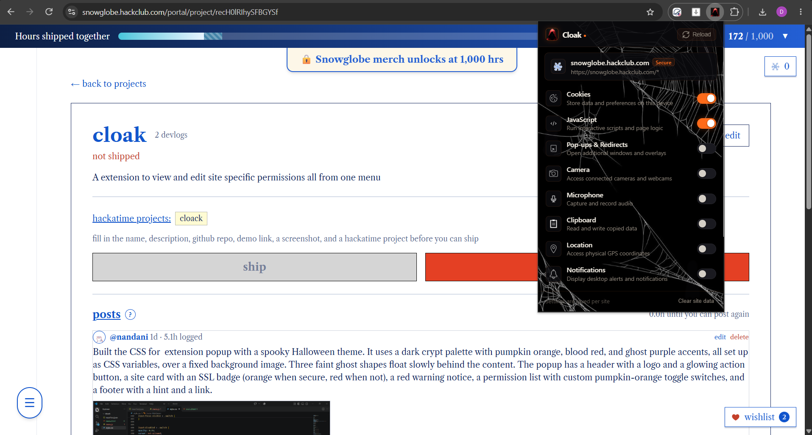
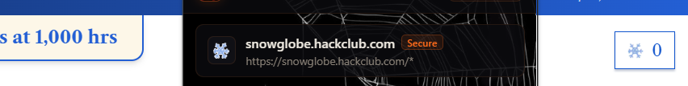
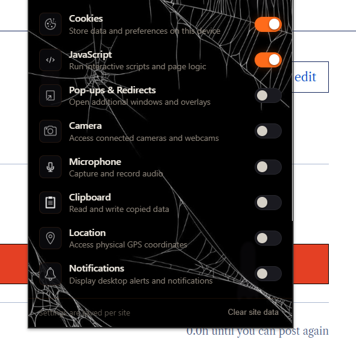

<h1>Cloak</h1>
View and edit site-specific permissions all from one menu.
  
<h2>Overview</h2>
Brave browser has a popup for listing site specific settings and statistics from one click, and with this extension its on Chrome also, the permissions menu (and especially the one for  specific websites) is hidden away within the chrome://settings directory.
<ul> 
<li>The top of the page shows the URL's origin, and any page that starts with this will be affected.

<li>Each permission shown is current, and any changes made will be saved on the device.

</ul>
<h2>Installation</h2>
<ol>
<li>Install from <a href="https://chromewebstore.google.com/detail/cloak/llnfpjblbgjfmgddaagnpdlkagcijmkl">Chrome Web Store</a></li>
<li>Click <strong>Add to Chrome</strong></li>
<li>Now edit permissions as you wish</li>